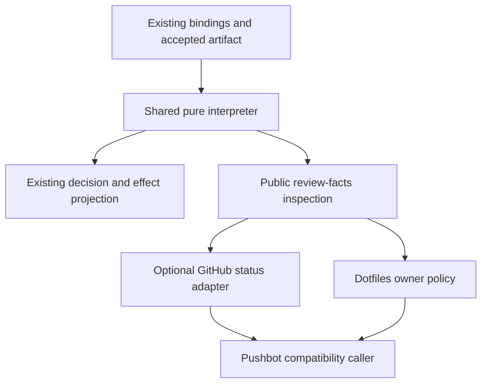
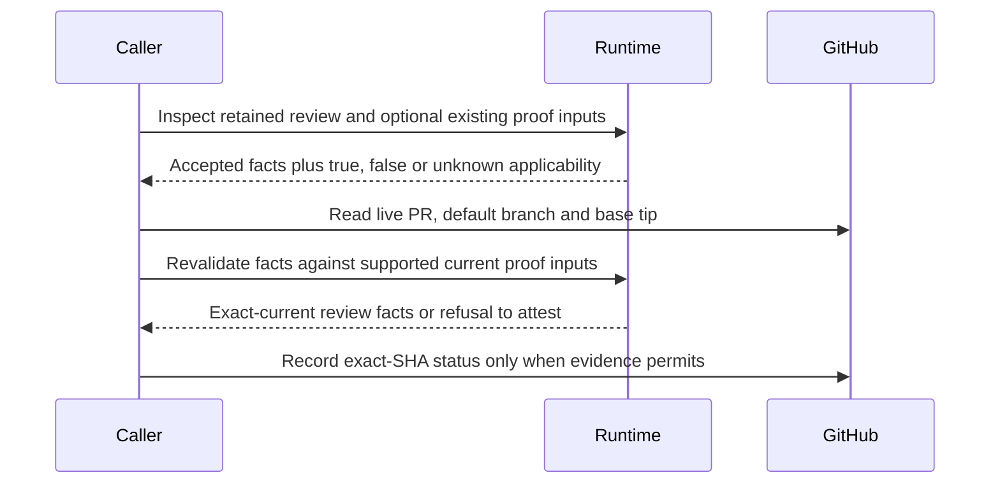

# Portable Review Facts - Plan

> **Implemented and retired, 2026-10-14; retained as decision history.** All six units shipped: the public interpreter, facts command and optional GitHub adapter in [Pro-gate264](https://github.com/StartupBros-com/pro-gate/pull/264), with selection/identity repairs in [266](https://github.com/StartupBros-com/pro-gate/pull/266) and [268](https://github.com/StartupBros-com/pro-gate/pull/268); [v0.61.2](https://github.com/StartupBros-com/pro-gate/releases/tag/v0.61.2) and [marketplace197](https://github.com/StartupBros-com/hov-marketplace/pull/197) completed public distribution; [dotfiles1786](https://github.com/StartupBros-com/dotfiles/pull/1786) and [Pushbot4557](https://github.com/StartupBros-com/pushbot/pull/4557) migrated both consumers after release. Release bytes and a clean installation were verified, and the installed cross-repository integration passed 22/22 tests. Pushbot's ready-state CI passed before its exact-head merge; review coverage limits remain disclosed on those PRs, not promoted into stronger claims here.
>
> Maintained behavior now lives in [README.md](../../README.md), the runtime and adapter tests, and the consumer implementations. The requirements and execution instructions below are historical, not pending work. Public review facts do not transfer owner policy or merge authority into Pro-gate. Broader transport/attempt facts in [175](https://github.com/StartupBros-com/pro-gate/issues/175), transport repair in [204](https://github.com/StartupBros-com/pro-gate/issues/204), and capture-quality work in [262](https://github.com/StartupBros-com/pro-gate/issues/262)/[263](https://github.com/StartupBros-com/pro-gate/pull/263) are outside this completed plan; abandoned estimator and connector-routing proposals remain abandoned.

## Goal Capsule

- **Objective:** Marketplace users and our automation can use verified review results without installing private repositories or interpreting Pro-gate's internal files.
- **Means:** Extend Pro-gate's public runtime with shared evidence interpretation and optional GitHub integration, then migrate the internal consumers (KTD1–KTD5).
- **Authority:** Operator-approved product scope on 2026-10-13; Requirements govern behavior, technical decisions govern implementation, and units govern neither.
- **Execution:** Six dependency-ordered units across Pro-gate, hov-marketplace, dotfiles and Pushbot; paths below are relative to each named repository.
- **Ownership:** The implementation host owns verification, release and consumer migration, not just the Pro-gate patch.
- **Stop conditions:** Stop for a broken compatibility invariant, conflicting concurrent changes or missing release evidence; do not retry stopped reviews or use operator-only overrides.
- **Retirement:** After release and both migrations are verified, maintained code, tests and public usage documentation replace this plan as authority.

---

## Product Contract

### Summary

Pro-gate supplies the review facts needed by its skill and external automation through its public runtime.
Optional GitHub status integration ships with the product; repository policy and merge execution stay with callers.
The plan covers the full agreed scope without broader governor or transport redesign.

### Problem Frame

Pushbot records and verifies generic Pro statuses, while dotfiles selects retained Pro artifacts and duplicates acceptance and severity parsing.
A normal marketplace installation receives neither capability.
The owner-stop fixes in dotfiles1711 and Pushbot4506 exposed the consequence: missing review evidence can be confused with no blockers unless each private caller reconstructs Pro's evidence rules.

### Key Decisions

- **Upstream capability instead of internal patchwork.** Governs R1, R7, R8 (session-settled: user-approved — chosen over extending private helpers: marketplace users must receive the capability too).
- **Review truth is separate from merge authority.** Governs R5, R6 (session-settled: user-approved — chosen over moving the whole PR owner into Pro-gate: callers retain their own policy).
- **One implementation, no new framework.** Governs R3, R9 (session-settled: user-directed — chosen over added machinery: the operator explicitly rejected bloat).

### Requirements

**Public review facts**

- R1. A supported normal Pro-gate installation exposes the selected accepted review's identity, artifact digest, reviewed revision, verdict and current applicability without Pushbot or dotfiles dependencies.
- R2. Current SHIP, valid historical evidence, missing evidence and invalid or incomplete evidence remain distinguishable; unknown is never reported as zero findings or current approval.
- R3. Caller-needed unresolved severity counts come from one runtime implementation and are bound to the accepted artifact rather than the best-effort round sidecars.
- R4. Reading these facts neither submits a review nor overrides a stop, and query/effect paths share the same evidence interpretation.

**Integration and policy**

- R5. Generic exact-revision GitHub status recording and verification are optional distributed capabilities; a successful Pro verdict requires valid current SHIP evidence.
- R6. Pro-gate does not grant merge authority, change repository rules, or turn our exemption and reviewed-stop policies into product defaults.
- R7. Existing internal command interfaces remain compatible while their duplicate evidence selection, validation and severity parsing are replaced by public Pro-gate calls.

**Delivery and restraint**

- R8. Completion includes a version-matched runtime/skill release, marketplace distribution, clean-install verification and migration of both internal consumers.
- R9. Extend existing contracts and storage without adding a parallel decision engine, new review ledger, policy framework or reporting dashboard.

### Acceptance Examples

- AE1. **Covers R1, R3, R8.** With no internal repositories installed, the public command reads a valid retained accepted review and returns its exact artifact/revision facts and unresolved counts; synthetic fixture results are not presented as a live model review.
- AE2. **Covers R2, R4.** A missing result, mismatched digest, wrong target or unreadable newest relevant completion cannot become a clean result or silently select an older favorable review, and inspection spends no review quota.
- AE3. **Covers R2, R5, R6.** A historical accepted review can be reported for caller policy, but does not attest SHIP at a later fixer head or produce a successful current Pro status.
- AE4. **Covers R5, R7.** Status recording and verification preserve target/base/head checks and reject stale or overlapping advancement, including either side of a rename.
- AE5. **Covers R6, R7, R8.** After migration, ordinary-prose handling, explicit reviewed-stop policy, CI waits, parking and merge execution retain their existing owner semantics while duplicate Pro evidence parsers are gone.

### Scope Boundaries

- R6 excludes a merge controller, automatic rule changes and review-policy redesign.
- R9 excludes an arbitrary-runtime abstraction, new ledger and reporting dashboard.
- Preserve existing options and compatibility surfaces under R7; remove duplicate implementations only when their public replacements are available.
- Considered and not built: a broader P2/P3 governor scorer. Current consumers need open P0/P1, and changing stop scoring is a different policy decision.
- Considered and not built: new recovery or retry machinery. Existing lifecycle commands already own those effects; inspection must remain pure under R4.

#### Deferred to Follow-Up Work

Capture quality and transport repair remain coordinated upstream work in Pro-gate262/263 and204.
Digest/provenance validation is not proof of review quality, and263 does not resolve genuine skeleton-only acceptance.
Issue175's abandoned upload estimator and size-to-connector routing remain abandoned, not future units of this plan.

### Sources

- [Issue175 revised direction](https://github.com/StartupBros-com/pro-gate/issues/175#issuecomment-5858508058): runtime facts first, wrapper removal after release; absent legacy observations stay unknown.
- `skills/pro-gate/SKILL.md`: typed continuation and no-merge boundary.
- `bin/oracle-review.sh`, `pg_review_decision_cli`: complete artifact validation and same-head candidate assembly.
- `lib/pro-gate-lib.sh`, `pg_round_note_severity` and binding readers: severity grammar and evidence contracts.
- [Dotfiles1711](https://github.com/StartupBros-com/dotfiles/pull/1711) and [Pushbot4506](https://github.com/StartupBros-com/pushbot/pull/4506): compatibility consumers.

---

## Planning Contract

### Key Technical Decisions

- KTD1. **Extract interpretation, not a second decision engine.** Move accepted-artifact validation from `pg_review_decision_cli` into pure runtime helpers used by both query and effect assembly (R1–R4, R9). Keep existing reducer projections and `review-decision/v1` actions intact; its `prior_review` means same-head/different-evidence, not cross-revision history.
- KTD2. **Add a thin inspection mode to the existing CLI.** `--review-facts --repo <checkout> --pr <number-or-URL> --json` returns a versioned facts object without invoking preparation, collection, repair, scoring or housekeeping (R1, R2, R4). Reuse existing proof-input options and environment contracts for applicability; ordinary retained inspection does not require fresh-review input-policy validation.
- KTD3. **Bind open counts to the accepted bytes.** Extract the current P0/P1 grammar into a pure reader and retain round-sidecar writes in `pg_round_note_severity` (R3, R9). Digest, verdict and counts must describe one consistent artifact snapshot; I/O or acceptance failures yield unavailable counts, not zero. Preserve status-position `RESOLVED`, existing case behavior, resolved/same-problem governor accounting and predecessor-binding compatibility.
- KTD4. **Port generic GitHub logic, keep owner policy downstream.** Distribute the existing Node recorder/verifier as an optional runtime adapter, preserving its command flags and reusable exports (R5–R7). It consumes public facts for recording, retains live base-repository/ref/SHA and head checks, and never imports dotfiles policy. The existing Pushbot `--owner-state` branch remains a compatibility caller, not a product default.
- KTD5. **Release before deleting private implementations.** Ship runtime, skill documentation and optional adapter together, verify exact release bytes and marketplace tuple, then migrate dotfiles and Pushbot (R7, R8). Old interfaces delegate to the installed public implementation and fail clearly when it is unavailable; no duplicated fallback parser.

KTD1 follows `docs/solutions/conventions/separate-review-lifecycle-applicability-capacity-and-input-trust.md` and `docs/solutions/conventions/ownership-lives-on-the-verdict-line-not-at-the-end-of-the-answer.md`.
KTD3 preserves the limitation documented in `docs/solutions/conventions/a-round-governor-scoring-only-p0-p1-is-blind-to-a-p2-only-fix-chain.md`: zero P0/P1 is not a clean verdict.
KTD5 follows `docs/solutions/conventions/a-staged-release-tag-can-predate-a-later-fix-on-the-same-version.md`; a version label does not establish packaged content.

### High-Level Technical Design

**Ownership and data flow**

**Selection and result shape**

Discover relevant completion candidates before acceptance validation.
Use existing marker/run metadata only to establish possible relevance, never to confer acceptance.
Order attributable candidates by existing charged epoch and canonical identity; an ambiguous relevant candidate or unreadable newest completion obstructs selection instead of disappearing behind an older valid result.
Do not make an unrelated repository's malformed record obstruct this target.

The facts object separates the queried candidate revision, selected marker, evidence state, accepted review and current applicability.
Accepted review facts carry repository/PR, reviewed head, evidence mode/identity, artifact digest, verdict, named-choice information and open P0/P1 counts.
Invalid or incomplete candidates carry a reason and no accepted counts.
No caller reads storage directories or round tuples to fill missing fields.

| Evidence state | Retained facts | Applicability |
|---|---|---|
| No relevant completion | No accepted review | Unknown |
| Relevant selection ambiguous | Reason, no selected acceptance | Unknown |
| Selected candidate invalid/incomplete | Candidate identity where known; unavailable counts | Unknown |
| Valid accepted result, no current proof | Historical facts and counts | Unknown |
| Valid result, proven different head/evidence | Historical facts and counts | False |
| Valid result, matching current proof | Accepted facts and counts | True; verdict still controls SHIP |

**Current-proof protocol**

The optional adapter may use the existing explicit evidence-preparation command where required; that is a separate caller effect, not an inspection side effect.
Matching HEAD alone is insufficient: existing metadata, endpoint/reviewed bytes and scoped manifest/confirmation requirements remain in force.
Status verification also preserves the existing base-advancement overlap checks; a successful check remains an input to the caller, not permission to merge.

### Assumptions

- Public unresolved counts initially mean open P0 and P1 because those are the existing callers' inputs; verdict and named-choice fields remain independently significant.
- The new facts envelope is additive rather than an expansion of the exact-key reducer grammar. Exact field names can be finalized in U2 without changing these semantics.
- The optional Node adapter uses the runtime's existing supported Node environment; core retained inspection requires no GitHub authentication or network access.

### Sequencing

U1 → U2 → U3 → U4 → U5 → U6.
U1–U3 can ship in one Pro-gate feature PR; each includes its real tests.
U4 is the existing release train and marketplace repin, not a new delivery framework.
Coordinate overlapping capture edits with263 before changing shared validation code.
Keep issue175 open for its remaining transport work; this plan is a referenced subset, not a claim to close that broader issue.

---

## Implementation Units

### U1. Share accepted-artifact interpretation and severity reading

- **Goal:** Runtime callers derive the same facts from the same accepted bytes.
- **Requirements:** R1–R4, R9; KTD1, KTD3.
- **Dependencies:** None.
- **Files — Pro-gate:** `lib/pro-gate-lib.sh`, `bin/oracle-review.sh`, `tests/engine.test.sh`, `tests/round-continue.test.sh`.
- **Approach:** Extract complete validation, including input/result digests, provenance, verdict, named choices and SHIP proof relationships. Replace inline interpretation and the severity writer's parsing with shared helpers; preserve their distinct output projections.
- **Execution note:** Characterize existing decision and severity behavior before refactoring.
- **Test scenarios:**
  - Covers AE1. A valid accepted artifact yields its exact digest/verdict and open P0/P1 counts.
  - `RESOLVED` in status position excludes a finding; the word in descriptive text or `RESOLVED_MODEL` does not.
  - Covers AE2. Unreadable, changing, digest-mismatched or foreign-owned bytes produce no accepted counts.
  - A P2-only FIX-FIRST stays FIX-FIRST with zero P0/P1; valid predecessor bindings retain their established behavior.
  - Existing current, prior-evidence, collect-only and repair fixtures retain their actions.
- **Verification:** Existing engine, continuation and adapter-parity suites pass without weakened assertions or regenerated expectations that hide behavior changes.

### U2. Expose retained review facts through the public CLI and skill

- **Goal:** A standalone consumer can inspect accepted evidence without private parsers.
- **Requirements:** R1, R2, R4, R6, R9; AE1–AE3; KTD1–KTD3.
- **Dependencies:** U1.
- **Files — Pro-gate:** `bin/oracle-review.sh`, `lib/pro-gate-lib.sh`, `skills/pro-gate/SKILL.md`, `README.md`, new `tests/review-facts.test.sh`, `.github/workflows/ci.yml`.
- **Approach:** Add early inspection dispatch, the additive envelope and deterministic historical selection described above. Document proof inputs, unknown results and no-merge authority; keep `review-decision/v1` the sole continuation-action source.
- **Test scenarios:**
  - Covers AE1. Invoke the installed CLI with retained evidence and no internal repos, network, current proof or valid fresh-review delivery policy; return historical facts with unknown applicability.
  - Covers AE2. A newer invalid/unreadable relevant completion obstructs an older SHIP; unrelated malformed records do not. Ambiguous ordering never chooses a favorable winner.
  - Covers AE3. Advanced HEAD or changed evidence returns historical validity without current approval; complete matching proof returns true applicability.
  - Invalid combinations with review, recovery or effect flags fail as usage errors before effects.
  - Snapshot runtime state before and after inspection and trap effect entrypoints; no files, quota counters, bindings or browser state change.
- **Verification:** New suite is included exactly once in CI, and existing decision-action fixtures remain unchanged.

### U3. Distribute the generic GitHub status adapter

- **Goal:** Marketplace users can record and verify exact-revision Pro statuses without Pushbot.
- **Requirements:** R5, R6, R7; AE3, AE4; KTD4.
- **Dependencies:** U2.
- **Files — Pro-gate:** new `bin/record-pro-gate-verdict.mjs`, new `tests/github-status.test.mjs`, `install.sh`, `README.md`, `.github/workflows/ci.yml`.
- **Source to port — Pushbot:** `tooling/scripts/record-pro-gate-verdict.mjs` and its existing test suite.
- **Approach:** Move generic record/verify/base-overlap helpers without changing their established checks or exports. Replace trust in verdict arguments with validation against public facts; keep those arguments as compatibility assertions. Export the shared base/overlap utility needed by downstream policy instead of duplicating it there.
- **Test scenarios:**
  - A valid current SHIP posts one success at the reviewed SHA with exact base identity; explicit non-SHIP evidence never posts success.
  - Covers AE3. Missing, historical, invalid or named-choice evidence cannot post success even when arguments say SHIP.
  - Covers AE4. Moved head, foreign/non-default base, stale base with overlapping edits and either side of a rename refuse verification; unchanged or proven disjoint advancement retains existing behavior.
  - Failed evidence preparation, truncated GitHub reads or API errors produce no success status.
  - The distributed adapter imports no dotfiles path, owner state or merge command.
- **Verification:** Ported behavioral tests and new facts-bound recording tests pass through the public entrypoint; mocked GitHub calls are reported as contract tests, not live attestation.

### U4. Release and verify the actual marketplace installation

- **Goal:** The capability reaches normal users before private implementations are removed.
- **Requirements:** R8; AE1, AE5; KTD5.
- **Dependencies:** U1–U3.
- **Files — Pro-gate:** `VERSION`, `.claude-plugin/plugin.json`, release notes under `docs/release-notes/`, `scripts/package-runtime.sh`, `install.sh`, `tests/distribution.test.sh`, `tests/release-assets.test.sh`, `tests/release-train.test.sh` where required.
- **Files — hov-marketplace:** `.claude-plugin/marketplace.json` and existing pin-validation tests.
- **Approach:** Select the next unclaimed version, keep skill/runtime identities aligned, and follow the existing draft-package → reviewed marketplace repin → publish sequence. Verify the actual tagged and uploaded bytes, not a later branch carrying the same version.
- **Test scenarios:**
  - Covers AE1. Install the exact release in an isolated HOME with neither Pushbot nor dotfiles, seed explicitly synthetic retained evidence, and exercise inspection plus the optional adapter.
  - Version/identity skew, a corrupt result digest and absent runtime entrypoints refuse clearly.
  - Existing supported installation layouts preserve their skill/agent ownership and CLI paths.
- **Verification:** Distribution/release suites pass, release asset digests and marketplace version/SHA match, and installed entrypoints execute from the downloaded package. Do not claim a live model review from fixtures or resubmit stopped reviews for proof.

### U5. Replace dotfiles evidence parsing with the public query

- **Goal:** The owner keeps policy but no longer reconstructs Pro review truth.
- **Requirements:** R6, R7; AE2, AE3, AE5; KTD4, KTD5.
- **Dependencies:** U4.
- **Files — dotfiles:** `claude/scripts/pr-owner-merge-evidence.sh`, `claude/scripts/lib/pr-owner-review-select.py`, `claude/scripts/pr-owner.sh`, their existing merge-evidence/owner/recovery test suites and affected installed consumers.
- **Approach:** Inventory every caller before removing local selection/acceptance/severity code. Delegate to public facts and shared generic base checks; preserve the helper interface, candidate binding and ordinary-prose branch. Preserve operator-required decisions rather than converting stops into automatic permission.
- **Test scenarios:**
  - Covers AE5. Existing exemption and explicitly permitted reviewed-stop outcomes produce the same owner dispositions and evidence identities.
  - Covers AE2. Newest invalid evidence, unavailable counts, named choices and open P0 continue to park/refuse; an older favorable review cannot bypass them.
  - Covers AE3. Historical zero-P0 evidence is labeled historical at a fixer head and creates no successful current Pro status.
  - Missing/old public runtime fails with an upgrade instruction, never a private parsing fallback.
- **Verification:** Existing owner, recovery and merge-evidence suites pass against the released public entrypoint; no consumer still sources Pro's private library to interpret evidence.

### U6. Turn the Pushbot verifier into a compatibility caller

- **Goal:** Pushbot uses the distributed generic verifier while preserving its owner-policy opt-in.
- **Requirements:** R5–R8; AE4, AE5; KTD4, KTD5.
- **Dependencies:** U4, U5.
- **Files — Pushbot:** `tooling/scripts/record-pro-gate-verdict.mjs`, `tooling/scripts/record-pro-gate-verdict.test.mjs`, all callers and tests found by a bounded caller inventory.
- **Approach:** Delegate strict recording/verification and generic utilities to the installed Pro adapter. Keep `--owner-state` as downstream composition over the migrated owner helper, preserving existing flags, exports, exact-candidate checks and failure behavior.
- **Test scenarios:**
  - Covers AE4. Existing default strict-SHIP invocations and base/head/rename regressions exercise the distributed implementation through the old entrypoint.
  - Covers AE5. Explicit owner-state exemptions/stops retain downstream semantics without recording SHIP, and missing owner evidence refuses.
  - A clean installation without dotfiles still supports the public strict adapter; only the explicit internal owner-policy branch depends on dotfiles.
- **Verification:** Run existing verifier tests, affected policy checks and final installed-path smoke for both consumers. Search confirms no duplicate Pro artifact selector, acceptance parser or severity parser remains in either consumer.

---

## Verification Contract

Commands are source-identified requirements for implementation, not a record of tests already run.
Use each repository's working directory and current instructions.

| Scope | Check | Required evidence |
|---|---|---|
| Pro source | `bash scripts/validate-source.sh` | Data/shell validation passes; validate new Node files with the existing Node toolchain |
| Interpreter | `bash tests/engine.test.sh` and `bash tests/round-continue.test.sh` | Real existing suite execution; all three engine shards if using sharded mode |
| Public contracts | `bash tests/review-decision-adapters.test.sh`, new facts/status suites | Existing action parity plus positive accepted facts and fail-closed negatives |
| Packaging | `bash tests/distribution.test.sh`, `bash tests/release-assets.test.sh`, `bash tests/release-train.test.sh` | Exact packaged entrypoints, identities and release ordering |
| Complete Pro regression | Every test leg in `.github/workflows/ci.yml`; `bash tests/ci-assurance.test.sh` | No skipped or unregistered new suite; trusted check green at the reviewed head |
| Pushbot | `node --test tooling/scripts/record-pro-gate-verdict.test.mjs` plus affected repository lint/type/policy checks | Old interface delegates successfully and preserves strict/default behavior |
| Dotfiles | Existing owner, recovery and merge-evidence suites | Released runtime is exercised; stop/exemption policy is not changed |
| Release/install | Existing release train and clean isolated installation | Downloaded bytes match the release and marketplace pin; no private repository dependency |

Use real code and real tests in each feature unit.
Start negatives from invalid stored bytes, newer corrupt completions and wrong revisions rather than hard-coded refusal paths.
Do not regenerate fixtures merely to force green, weaken gates, suppress stderr or describe a mock as live proof.
No build/typecheck is invented for the Bash runtime; apply the repository's actual validators and the consumers' existing checks.
An independent review cites the exact implementation revision; host verification re-executes commands rather than accepting worker claims.

---

## Definition of Done

- U1–U3 each pass their positive and negative scenarios without changing continuation, governor or caller-policy semantics outside R1–R9.
- U4's published runtime, skill and marketplace pin are version-matched and exercised in a clean installation.
- U5 and U6 run through public interfaces; only downstream policy remains private.
- Existing flags, exports, predecessor evidence compatibility and supported install layouts remain available.
- Final evidence distinguishes runtime fixtures, mocked GitHub contract tests, installed-release execution and any real retained-review readback actually performed.
- No stopped review was retried and no override or merge authority was introduced.
- Remove abandoned implementation attempts and duplicate parsers after their replacements pass; keep useful historical documentation as history.
- A plan, branch, draft release or private-only fix does not satisfy R8. Unfinished release or migration keeps the task open.
